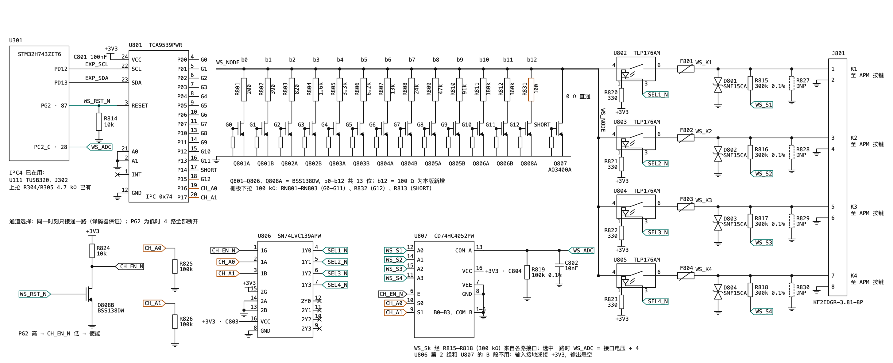
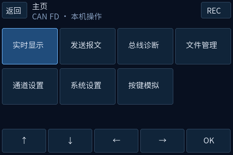
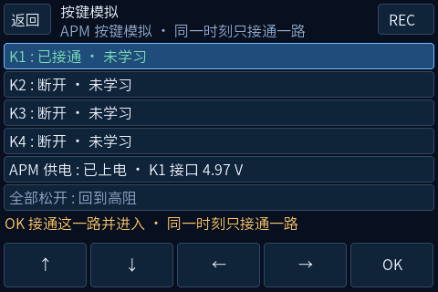
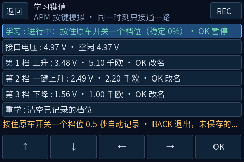

# APM 按键模拟：进展

在 Hardware-C 监控器上增加 APM 车窗开关的按键模拟：设备在 APM 的按键输入上模拟原车开关的各个档位，可以学习原车开关的键值、扫描 APM 的档位门限，再用学到的键值去“按”APM。最多 4 路，同一时刻只按一路。

## 现在到哪一步

| 部分 | 状态 | 位置 |
| --- | --- | --- |
| 原理图第 12 页第 2 版 | 设计完成，是提案；还没画进嘉立创EDA，没有 PCB | `schematic/` |
| 驱动（winsim） | 完成，主机测试通过 | `fw/services/winsim/` |
| 按键模拟服务和界面（keysim） | 完成，桌面模拟器里可以操作；Rev D/E 固件上不显示入口 | `fw/services/keysim/`、`fw/app/ui/core/ui_sm.c` |
| 键值表存 SD 卡 | 完成；板级存储代码在 RAM 卡上测试通过 | `fw/services/keysim/keysim_file.*`、`fw/platform/stm32h743_revd/storage_files.inc` |
| 交互原型和现有界面梳理 | 完成，作为讨论记录保留 | `ui/` |
| Hardware-C 板级移植、实板联调 | 没开始 | — |



## 定下来的方案

- **4 路共用一套电阻阵。** 因为同一时刻只按一路，K1–K4 用 4 个 TLP176AM 光耦继电器分别接到公共节点，SN74LVC139A 译码，硬件上保证不会同时接通两路。PG2 为低时 4 路全断。
- **电阻阵 13 位。** 每路串联 PTC 和继电器，约 5–17 Ω，所以在低阻端加了 b12 = 100 Ω，200 mV 这一档才够得着。
- **回读在每路接口侧。** 300 kΩ 分压上臂放在各路接口，CD74HC4052 选通后经 100 kΩ 下臂接 PC2_C。这样任何一路都能在原车开关接着时被动学习。
- **串联电阻自动标定。** 每次切换通道时用 0 Ω 直通档量一次，之后按实际值求解。仿真里 200–4600 mV 最差误差 19 mV（要求 25 mV）。
- **主控引脚只用 PG2、PC2_C**，PC3_C 仍空着；I/O 扩展 TCA9539 挂在现有的 I2C4。
- **键值表存 SD 卡**，每路一个纯文本文件 `/APMKEY/K1.TXT … K4.TXT`，电脑上可以直接看、改、拷到别的设备。
- **Hardware-C 是纯触摸**，主控上没有按键，电源是拨动开关 SW101。现有界面里依赖实体键的长按回主页、POWER 熄屏和关机、组合键锁键、开机进升级，在新板上都要改；详见 `ui/ui-logic-map.html`。

## 界面

主页第 7 格“按键模拟”，主页变成 4×2。下面四页都是设备现有的列表样式：

- **总览：** K1–K4 是否接通、有没有键值表、是否已存 SD；APM 供电；全部松开。
- **通道页：** 接口电压和 APM 判定、按法（点按 300 ms / 保持）、各键、手动电压、学习、扫描、串联电阻、键值表存储状态。
- **学习键值：** 按住原车开关一个档位 0.5 秒自动记一档，显示电压和反推的开关电阻。
- **门限扫描：** 从 4.8 V 每 50 mV 往下设，读 APM 开关状态，记下门限，保存时每档取中点。

| 主页 | 总览 | 学习 |
| --- | --- | --- |
|  |  |  |

这几张是 `run_ui_host.py` 在电脑上运行真实 LVGL 代码画出的设备画面（480×320）。

## 怎么试

```sh
make -C fw sim
```

打开 http://localhost:8765，启动设备后点主页的“按键模拟”。右侧“环境”里的台架可以唤醒或休眠 APM、给每一路接上或断开原车开关、按住某个档位、模拟误接 12 V。学好一路并保存后，长按 POWER 关机再开机，键值表会从模拟 SD 卡读回来。

测试：

```sh
make -C fw test-winsim                                # 驱动
make -C fw build/host/test_keysim_ui && fw/build/host/test_keysim_ui
make -C fw test                                       # 全部主机测试，含上面两个和 SD 存储
```

## 测试和构建结果

- 驱动 1372 项、界面 466 项、键值表文件格式 50 项、板级 SD 存储（`test_storage_sd_winsim`）全部通过，均在 ASan/UBSan 下运行。
- Rev E 发布检查的主机部分全部通过。`make -f Makefile.arm BOARD=reve check`（Arm GNU Toolchain 15.2.Rel1）通过，Flash 多约 8 KB，RAM 多 64 字节；Rev E 上按键模拟是空壳，不分配约 33 KB 的驱动上下文，主页仍是 6 格。
- 只在有这部分硬件的目标上编译的代码（定义 `CANFD_WINSIM_HW`）也用 Arm GCC 单独编译检查过，没有告警。
- 与本工作无关、在 main 上同样失败的：`test-web` 里依赖 canmatrix 的几项（本机没装），一项 macOS 上的并发连接测试，以及 `test-rtos` 的链接错误（它的源文件列表少了文件）。

## 还没定、还没做

- **扫描用的 APM 开关状态信号**（哪条 CAN 报文、哪个字段）还没有配置界面。模拟器里由仿真 APM 直接给出，真实 APM 上现在读不到，扫描用不了。
- **原车开关松开时 APM 看到的是开路还是固定电阻**还没确认。目前按开路处理；每路预留了一个空闲电阻位（R827–R830，默认不贴）。
- **PTC 料号**没定，精度按 5–17 Ω 估算。15 V 的 TVS 只按 12 V 车设计，误接 24 V 会烧。
- **“按住才生效”的按法**需要触摸的按下 / 抬起事件，现有手势只有点击，所以只做了点按和保持。
- **APM 唤醒报文**仍需在发送报文页手动发。
- **Hardware-C 纯触摸要改的交互**（主页按钮、关机、锁键、升级入口）和**板级移植**（I2C4、PG2、ADC3_INP0 回调，定义 `CANFD_WINSIM_HW`）没做。
- 原理图没画进嘉立创EDA，没有 PCB、DRC，也没有实板测试。

## 本目录的文件

| 文件 | 内容 |
| --- | --- |
| `schematic/page12-rev2.html` | 第 12 页第 2 版：原理图、4 路切换说明、引脚分配、电阻阵、元件清单、逐脚网表。下载后用浏览器打开 |
| `schematic/page12-rev2.svg` / `.png` | 原理图图片 |
| `schematic/page12-rev2-netlist.json` | 逐脚网表，格式与 Hardware-C 的 schematic-pins.json 相同，画完 EDA 后可以逐脚对照 |
| `tools/gen_page12_v2.py` | 生成上面这几个文件的脚本：`python3 gen_page12_v2.py out.html preview.svg` |
| `ui/ui-logic-map.html` | 现有界面的页面导航、按键与触摸映射、Hardware-C 上要改的地方。末尾的“草案”是实现之前的设想 |
| `ui/prototype.html` | 实现之前做的可点击原型，用来讨论交互。和实际实现的差别：原型的入口在主页第 3 格、有“按住”按法、用自定义卡片布局；实际实现放在第 7 格、只有点按和保持、沿用设备的列表样式 |
| `ui/device-screens/` | 实际实现后的设备画面 |

HTML 文件在 GitHub 上只显示源码，下载后用浏览器打开即可，不需要联网以外的任何依赖。
